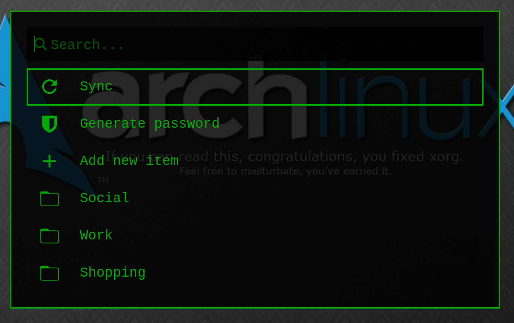

# rbw_custom_design

A custom Bitwarden menu built on top of [`rbw`](https://github.com/doy/rbw) (the
unofficial Bitwarden CLI) for Sway/wlroots, using
[`walker`](https://github.com/abenz1267/walker) +
[`elephant`](https://github.com/abenz1267/elephant) (the `elephant-bitwarden`
provider), with a black-and-green "retro" look.

A keybinding opens a floating window listing folders, with live fuzzy search
across the whole vault; from an entry you can copy the password/username/TOTP,
edit it, or delete it. `rbw` stays the single source of truth (vault, sync,
locking) — this repo is just a UI layer on top of it.



## Architecture

```
$mod+b (Sway)
  -> bin/bitwarden-launcher
       -> bin/bitwarden-generate-menus   (rbw list --raw -> TOML menu files for elephant)
       -> systemctl --user restart elephant.service   (see "Known issues" below)
       -> walker -s bitwarden
            - empty field  = static menu (folders, generated above)
            - typing       = live search via the elephant-bitwarden provider
```

Actions on an entry (copy password/username/TOTP, edit, delete) call
`bin/bitwarden-menu-copy <id> <action>`, which does a direct `rbw get`/
`rbw code`/`rbw remove` call and sends the password to the clipboard via
`wl-copy` (auto-clearing the clipboard after 45s for passwords).

`bin/rbw-rofi-menu` is an older alternative frontend (rofi script-mode
instead of walker) — functional, but currently not wired to any keybinding.
Kept for reference/completeness.

## Dependencies

- `rbw` (Bitwarden CLI) + `pinentry-gtk`
- `walker` + `elephant` (`elephant.service` as a `systemctl --user` service)
  + the AUR package `elephant-bitwarden` (provides the `bitwarden` provider)
- `jq`, `wl-clipboard`, `iconv` (`glibc`)
- Sway/wlroots (the floating rule in `sway/rbw-bitwarden.conf` is Sway-specific)

## Installation

1. Copy `bin/*` to `~/.local/bin/` (keep them executable; `.bitwarden-lib.sh`
   and `.bitwarden-editor-fill` must keep their leading dot — they're sourced
   by exact name).
2. Copy `themes/pinentry-green/gtk-3.0/gtk.css` to
   `~/.themes/pinentry-green/gtk-3.0/gtk.css`.
3. Add `sway/rbw-bitwarden.conf` to `~/.config/sway/config` (include it or
   copy its contents in manually).
4. Use `rbw/config.example.json` as a template for `~/.config/rbw/config.json`
   (fill in your own email; `"pinentry": "pinentry-rbw"` is the important
   part — see below).
5. `rbw config set email <your-email>`, `rbw login`,
   `systemctl --user enable --now elephant.service`.

## Known issues, and why the scripts look the way they do

Three independent bugs that all looked the same from the outside ("after
unlocking rbw, search/login stops working"):

### 1. `elephant-bitwarden` permanently returns 0 results after an auto-lock

`elephant.service` runs persistently in the background, and its `bitwarden`
provider holds its own connection to `rbw-agent`, established at the moment
the vault was last locked. After re-unlocking (`rbw` has a `lock_timeout`),
this connection doesn't refresh itself — the static folder menu still works
(it's regenerated fresh via `rbw list`), but live search permanently reports
0 results until `elephant.service` is restarted.

**Fix:** `bin/bitwarden-launcher` therefore ALWAYS (not conditionally) calls
`systemctl --user restart elephant.service` before `exec walker -s bitwarden`
— the cost is ~1-2s extra on every open, but unconditional restart is
necessary because "was it locked" can't be reliably detected (the user might
run `rbw unlock` outside this script too).

### 2. `pinentry-gtk` can't unlock the vault on Sway/wlroots

Two independent causes, both fixed by `bin/pinentry-rbw` (the wrapper that
`"pinentry"` in `rbw config.json` points to):

- **Global X11 grab.** `pinentry-gtk` grabs the keyboard/pointer globally by
  default (via XWayland), which conflicts on wlroots compositors ("could not
  grab keyboard: already grabbed", "it took 4097 tries to grab the pointer")
  and the unlock ends up as "pinentry cancelled". Fixed with
  `--no-global-grab` (grabs only while the window is focused).

- **`rbw-agent` always passes `--display :1`.** Even with `--no-global-grab`,
  window mapping still failed if `rbw-agent` (inheriting `$DISPLAY` from its
  own startup) passed pinentry an explicit `--display`, forcing GTK onto the
  X11/XWayland backend instead of native Wayland — the window then never
  mapped at all (verified by direct comparison: 0 mapped windows with
  `--display`, always 1 without it). The wrapper filters this flag out and
  additionally sets `GDK_BACKEND=wayland` explicitly.

### 3. The green look (`themes/pinentry-green`)

Adwaita-dark draws the entry focus ring (`entry:focus`) with a hardcoded blue
(`box-shadow: ... #15539e`), not through a theme variable
(`@theme_selected_bg_color`) — so a generic black-and-green `window`/`dialog`
override (used elsewhere on the system) doesn't catch it. A separate GTK
theme (`GTK_THEME=pinentry-green`, set in `pinentry-rbw`) imports the base
Adwaita-dark theme and overrides only `entry:focus`/`selection`/
`.suggested-action`, without touching the selection color anywhere else on
the system.

## What's deliberately NOT in this repo

The generated `~/.config/elephant/menus/gen-bitwarden-*.toml` files (contain
real entry/folder names from the vault) and `~/.config/rbw/config.json` with
a real email — both are runtime/personal state, not code. The screenshot
above was captured with temporary fake menu data on an otherwise empty
workspace for the same reason.
